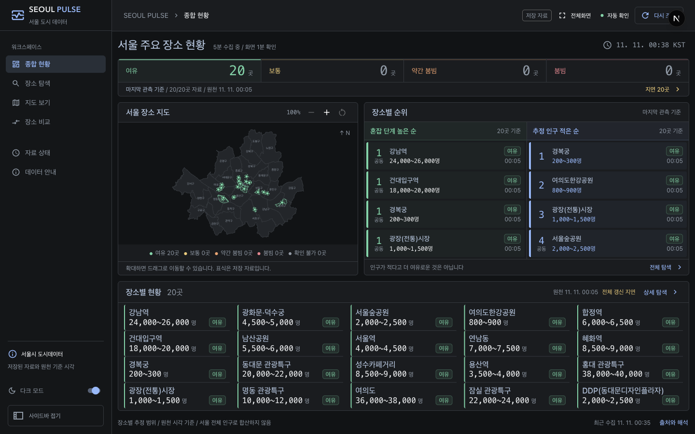
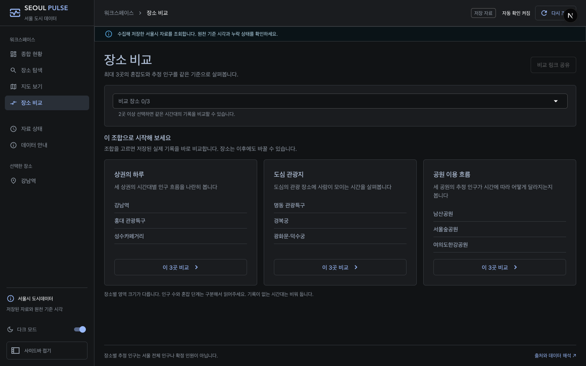

# SEOUL PULSE

**서울 주요 장소의 혼잡도와 하루의 인구 흐름을 한눈에.**

SEOUL PULSE는 서울 주요 20곳의 혼잡도와 추정 인구를 지도, 순위, 그래프로 보여주는 대시보드입니다. 전체 현황을 살펴보고 관심 있는 장소를 선택하면 최근 24시간의 변화를 확인할 수 있습니다.

**20곳의 장소 현황 / 최근 24시간 인구 흐름 / 최대 3곳 비교**

*실제 수집 자료를 표시한 화면입니다. 수치는 촬영 시점 기준입니다.*

## 어디가 붐비는지, 언제 달라졌는지

같은 서울 안에서도 장소마다 사람이 모이는 시간과 혼잡 정도는 다릅니다. SEOUL PULSE는 장소별 현황과 시간에 따른 변화를 함께 보여줘, 관심 있는 지역의 상황을 살펴볼 수 있도록 만들었습니다.

첫 화면에서는 20곳의 혼잡 분포와 장소별 순위를 확인합니다. 지도나 목록에서 장소를 고르면 해당 장소의 인구 흐름으로 이어지고, 여러 장소가 궁금할 때는 같은 시간대를 기준으로 비교할 수 있습니다.

## 현황에서 비교까지

| 화면 | 확인할 수 있는 것 |
| --- | --- |
| 종합 현황 | 주요 20곳의 혼잡 분포, 혼잡 단계가 높은 장소와 추정 인구가 적은 장소 |
| 지도 | 장소의 위치와 주변 분포. 확대와 이동으로 가까운 장소를 자세히 탐색 |
| 장소 탐색 | 장소명 검색과 혼잡도 필터로 관심 장소 찾기 |
| 장소 상세 | 장소별 추정 인구 범위, 최근 24시간 변화와 날씨 |
| 장소 비교 | 최대 3곳의 인구 흐름을 같은 시간축과 인구축에서 비교 |

## 크게 띄워두고, 필요한 곳을 자세히

- **한 화면에 담은 현황판** — 큰 화면에서 지도, 혼잡 분포와 순위를 함께 확인합니다. 전체화면 모드로 띄워둘 수도 있습니다.
- **색상과 이름으로 읽는 혼잡도** — 여유부터 붐빔까지 단계를 색상과 문구로 함께 표시합니다.
- **장소를 따라 이어지는 탐색** — 전체 현황에서 관심 장소의 상세와 비교로 이동합니다. 선택한 장소와 비교 화면은 링크로 공유할 수 있습니다.
- **화면에 맞는 보기** — 라이트와 다크 모드를 제공하고, 모바일에서는 내용을 세로로 배치합니다. 지도와 목록 중 편한 방식으로 장소를 찾을 수 있습니다.

## 숫자와 함께 보는 기준

인구는 추정 범위로 표시하며, 관측 시각과 자료의 갱신 상태를 함께 안내합니다. 기록이 없는 시간은 비워 두고, 오래된 자료는 지연이나 만료 상태로 구분합니다.

표시 대상은 서울 주요 20곳입니다. 장소별 인구를 서울 전체 인구로 합산하지 않으며, 혼잡 단계와 인구 규모는 별도로 보여줍니다.

데이터 출처: [서울특별시 서울 열린데이터광장 도시데이터](https://data.seoul.go.kr/dataList/OA-21285/F/1/datasetView.do)

디자인 참고: Damir Sokolovsky의 [Unslop](https://heydamir.design/unslop), CC BY 4.0.
